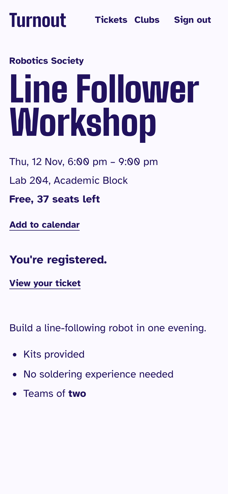
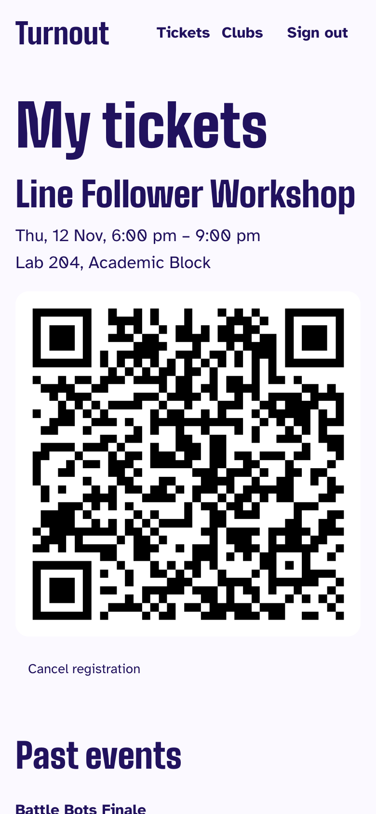
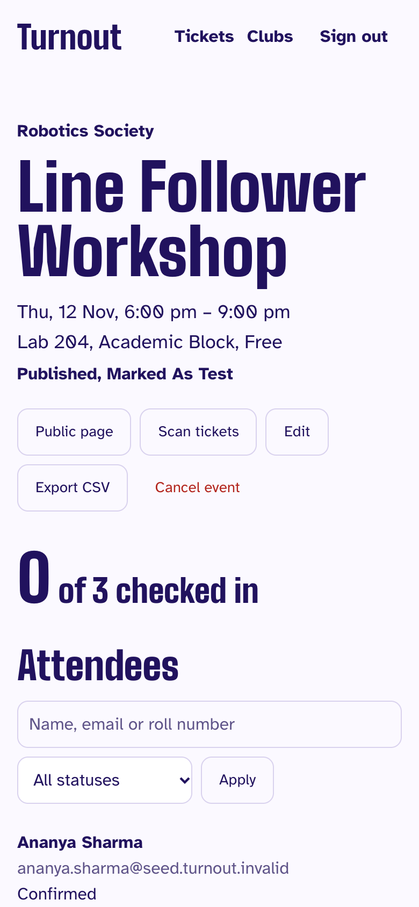

# Turnout

Every club event. One tap to get in.

Turnout is a club and event platform for a college campus. Clubs publish events, students register (free RSVP or paid tickets through Razorpay in test mode) and get a QR ticket, and volunteers scan tickets at the door from their phones.

<p>
  
  
  
  
</p>

## What's interesting about it

- **Capacity can't oversell.** A conditional `UPDATE` reserves seats, with a database constraint behind it. A test sends 50 simultaneous registrations at 10 seats and gets exactly 10.
- **A payment confirms exactly once.** The browser callback, the webhook and a reconciliation job can race, and row locking plus transactional job queueing produce one confirmation and one email.
- **A ticket checks in exactly once.** QR codes are HMAC-signed with no personal data, and one atomic update decides the winner when two phones scan at once.
- **Permissions live in one module**, tested for every role and every action.
- **Usage numbers are honest.** `/impact` is SQL over real tables, and demo data and test-mode payments are excluded.

The reasoning is in [docs/decisions.md](docs/decisions.md), the diagrams in [docs/architecture.md](docs/architecture.md), and a walkthrough in [docs/demo-script.md](docs/demo-script.md).

## Stack

Next.js (App Router), TypeScript, Tailwind CSS, shadcn/ui, PostgreSQL, Drizzle ORM, Better Auth, Zod, Razorpay, pg-boss, React Email with Gmail SMTP, Vitest, Playwright, k6, Sentry and pino.

## Run it locally

You need Node 26, pnpm 12 and Docker.

```bash
pnpm install
cp .env.example .env     # then fill in the values below
pnpm db:up               # Postgres on localhost:5434
pnpm db:setup            # migrations and job queues
pnpm db:seed             # optional demo data, all flagged is_test
pnpm dev                 # http://localhost:3000
pnpm worker              # in a second terminal: emails, reminders, reconciliation
```

In `.env`, set `BETTER_AUTH_SECRET` and `QR_SIGNING_SECRET` (`openssl rand -base64 32` for each) and the two Google values. Free events work with nothing else. Without Gmail values, emails are skipped with a log line in development.

### Google OAuth client

1. In [Google Cloud Console](https://console.cloud.google.com/), create a project.
2. Under **Google Auth Platform**, set up the consent screen with audience **External**.
3. Create an OAuth client of type **Web application**.
4. Add the redirect URI `http://localhost:3000/api/auth/callback/google`.
5. Copy the client ID and secret into `.env`.

While the app is in Testing mode, only accounts listed as test users can sign in.

### Become a super admin

Sign in once, then run:

```bash
pnpm admin:promote your.email@nst.rishihood.edu.in
```

After that, promote others from `/admin/super-admins`.

### Ticket emails

Turn on 2-Step Verification for a Gmail account, create an [App Password](https://myaccount.google.com/apppasswords), and set `GMAIL_USER` and `GMAIL_APP_PASSWORD`. Run `pnpm worker` to send.

### Payments in test mode

Set `RAZORPAY_KEY_ID`, `RAZORPAY_KEY_SECRET` and `RAZORPAY_WEBHOOK_SECRET` from the Razorpay dashboard in Test Mode. Test mode can't move real money.

| Method | Test details |
|---|---|
| Card (success) | `4100 2800 0000 1007`, any future expiry, any CVV, an OTP of 4–10 digits |
| Card (failure) | The same card, with an OTP shorter than 4 digits |
| UPI (success) | `success@razorpay` |
| UPI (failure) | `failure@razorpay` |

To receive webhooks locally, expose your dev server and point a Razorpay test webhook at it:

```bash
cloudflared tunnel --url http://localhost:3000
# or: ngrok http 3000
```

Use `https://<your-tunnel>/api/webhooks/razorpay` as the URL, enter your `RAZORPAY_WEBHOOK_SECRET`, and subscribe to `payment.captured`, `order.paid`, `payment.failed` and `refund.processed`.

## Commands

| Command | What it does |
|---|---|
| `pnpm dev` / `pnpm worker` | Start the web app / background worker |
| `pnpm lint` / `pnpm typecheck` | ESLint / type checks |
| `pnpm test` | Unit and integration tests (needs `pnpm db:up`) |
| `pnpm test:e2e` | Build, then run the Playwright browser test |
| `pnpm db:up` / `pnpm db:down` | Start / stop local Postgres |
| `pnpm db:setup` | Apply migrations and create job queues |
| `pnpm db:generate` | Create a migration from `schema.ts` |
| `pnpm db:studio` | Browse the database |
| `pnpm db:seed` | Add demo data, all flagged `is_test` (local databases only) |
| `pnpm admin:promote <email>` | Make an existing user a super admin |

## Door-rush load test

Simulates 300 people through the door with 10 scanners working at once, against a production build and a real database.

| Run | Successful check-ins | p95 latency | Failed requests |
|---|---|---|---|
| 1 | 300 of 300 | 34.7 ms | 0 |
| 2 | 300 of 300 | 22.1 ms | 0 |
| 3 | 300 of 300 | 34.0 ms | 0 |

Measured on an Apple M3 laptop with Postgres in Docker, so the web server and database are close together. Deployed latency will be higher.

To reproduce, build the app (`pnpm build`), start it against the test database with the values from `tests/integration/test-env.ts` on port 3100, then:

```bash
pnpm load:seed
docker run --rm -e BASE_URL=http://host.docker.internal:3100 \
  -v "$PWD/tests/load:/load:ro" -w /load grafana/k6:0.57.0 run checkin.js
```

## Deploy

**Database (Neon).** Create a project and run `pnpm db:setup` once with `DATABASE_URL` set to the **direct** connection string.

**Web (Vercel).** Import the repo; `vercel.json` sets the build. Add the environment variables from `.env.example`, using Neon's **pooled** connection string for `DATABASE_URL` and your Vercel URL for `APP_URL`. Add `https://<your-app>/api/auth/callback/google` to the Google OAuth client.

**Worker (Railway).** Deploy this repo as a service; `railway.json` selects `Dockerfile.worker`. Set the same variables, but use Neon's **direct** connection string, since the worker holds long-running connections. Gmail values go here, because the worker sends the email.

**Razorpay.** Add a test webhook at `https://<your-app>/api/webhooks/razorpay`. Automatic payment capture must be on in your Razorpay account settings so payments reach `captured`.
