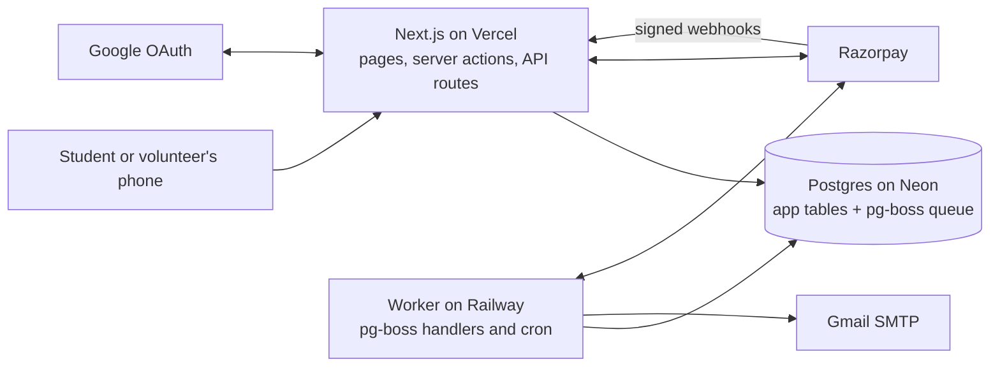
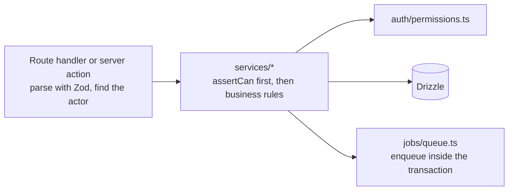
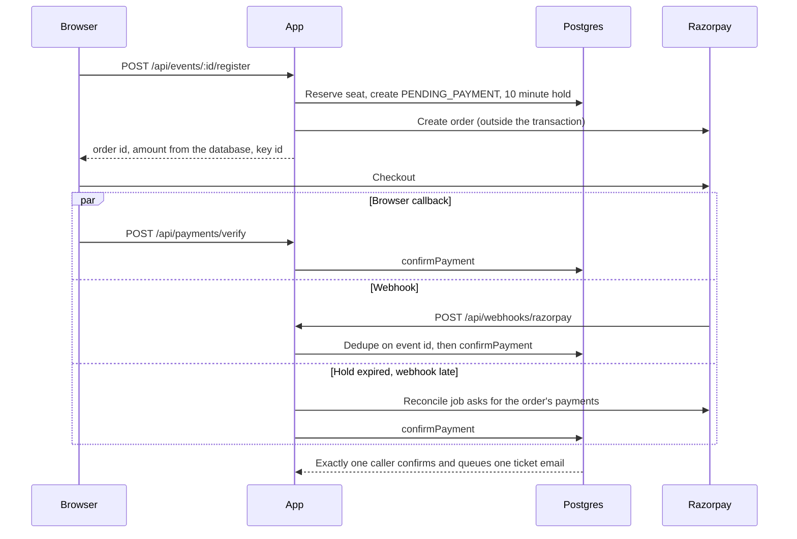
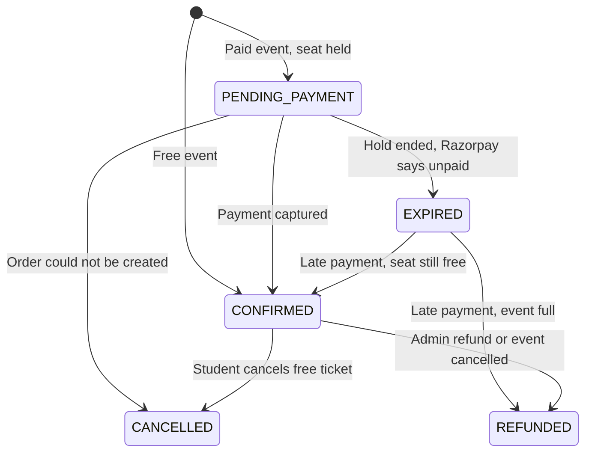
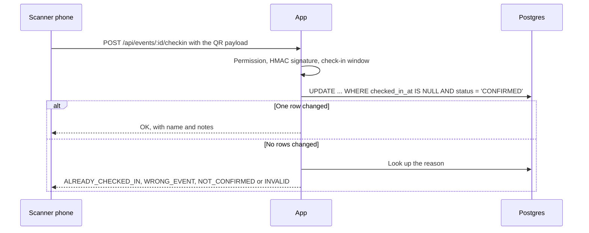

# Architecture

Turnout is one Next.js app and one background worker, sharing the code in `src/server` and one Postgres database.

## System

Inside `src/server`, requests move in one direction:

## Paid registration

Three things can confirm a payment: the browser, the webhook and the reconciliation job. All of them go through `confirmPayment`, which locks the payment row, so only the first one finds `PENDING_PAYMENT`.

## Registration states

## Check-in

## Background jobs

| Job | When | Why it's safe to repeat |
|---|---|---|
| `send-ticket-email` | Registration confirmed | Job id from the registration; `sent_emails` row per ticket |
| `send-cancellation-notice` | Event cancelled | Same |
| `event-reminder` | 24h and 2h before start | Key includes the start time; old jobs see they're stale |
| `expire-holds-and-reconcile` | Every minute | Conditional updates |
| `refund-registration` | Admin refund, cancellation, late payment | Checks Razorpay for an existing refund first |
| `post-event-summary` | 2h after end | Key includes the end time; `sent_emails` row per recipient |
| `metrics-snapshot` | Nightly | Upsert on the date |
| `complete-ended-events` | Every 5 minutes | Conditional update |
